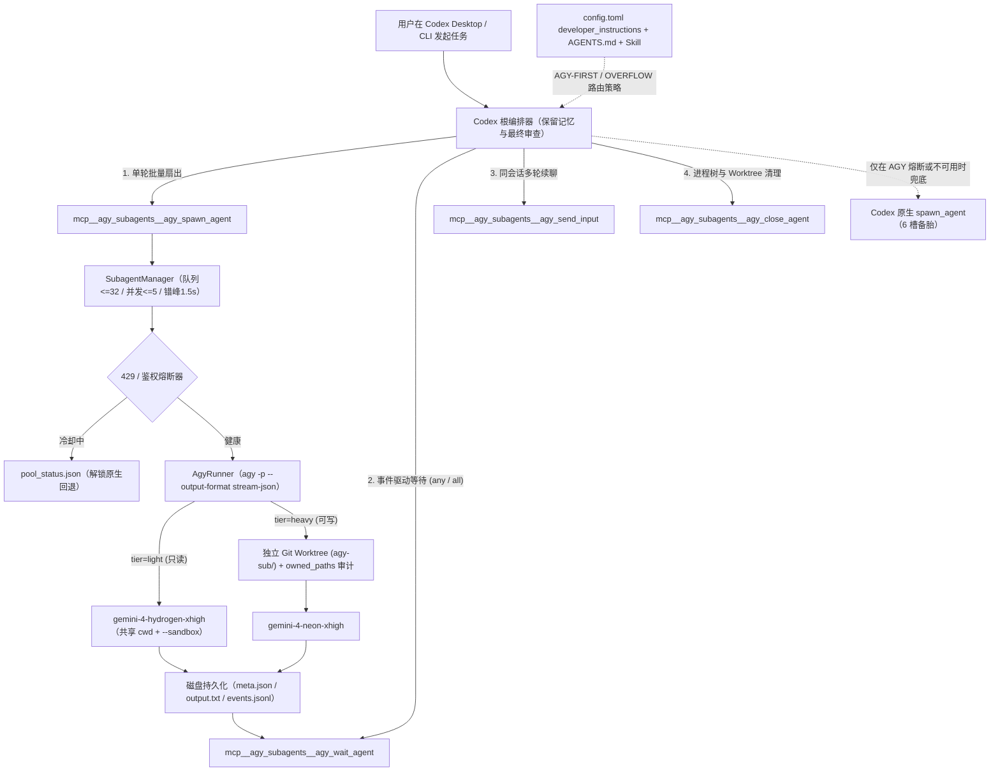

之前在知乎、CSDN 和小红书发了三篇不同风格的短平快介绍，这篇留在自己的个人博客，把 `codex-agy-subagents` 的**真实动机、协议级踩坑、核心实现细节和完整上手指南**一次性讲透。

::github{repo="Sereneoned/codex-agy-subagents"}

---

## 一、为什么要保留 Codex，而不是直接迁移？

如果你长期在 **OpenAI Codex（Desktop / CLI）** 里做日常开发，大概率会遇到一个非常现实的矛盾：

一方面，半年积累下来的会话习惯、项目记忆（memories）、工作流和 Skills 全都在 Codex 里，**主脑根本舍不得迁走**；另一方面，一遇到稍微大一点的多模块任务——例如并行读五六个子目录、同步排查多条日志链路、同时做代码审校和局部重构——纯靠 Codex 原生多代理就会立刻卡在几个硬限制上：

1. **同时最多 6 个原生 subagent**：任务一旦超过 6 路，后面的子任务只能排队阻塞；
2. **原生链路偏慢且昂贵**：像“翻大文件”“批量 grep + 摘要”这类只读探索型子任务，继续塞给 Codex 原生代理跑，时间与额度性价比都很低；
3. **本机明明已经登录了 Google Antigravity CLI（`agy`）**：Gemini 4 系列模型响应快、成本甜区好，以前却只能在两个窗口之间手动复制上下文，体验非常割裂。

所以我的目标非常明确：**让 Codex 继续当“总编排器（Root Orchestrator）”留住所有记忆和把关权，而把底层高频的并发探索、代码审查和分片编码工作，无感地派给本地官方 `agy` CLI 跑。**

---

## 二、为什么现成的简易 `agy` MCP，Codex 根本不会自己调？

最开始很多人（包括我最初排查时）都会以为：“写个 MCP Server 包一下 `agy -p` 不就完事了？”

实测在 Codex Desktop（`codex-cli 0.169.0-alpha.11.1`）里重启之后，你会发现一个很反直觉的现象：**哪怕你的 MCP 已经显示启动连接成功，Codex 在日常对话里还是只会条件反射地调内置 `spawn_agent`，根本不看你的外部工具一眼。**

排查本机特性清单与启动日志后，真正的原因有两层：

:::warning[两个让普通 MCP 桥接“隐身”的底层事实]
1. **Codex 默认启用了 `tool_search_always_defer_mcp_tools = true`**  
   新版 Codex 会把外部 MCP 工具的 Schema 默认延迟折叠进 `tool_search` / `ALL_TOOLS`。模型初始上下文里根本看不到外部子代理的工具定义，第一眼能直接看见的只有原生 `spawn_agent`。
2. **Codex Desktop 不会对用户级 `~/.codex/hooks.json` 自动弹信任提示**  
   试图只靠 `UserPromptSubmit` / `PreToolUse` Hook 去拦截并重定向 `spawn_agent`，在命令行需要额外信任，在桌面端则直接被静默跳过，很难实现开箱即用。
:::

实测 `codex debug prompt-input` 后找到的破局点非常干净：**把规则写进 `~/.codex/config.toml` 的顶层 `developer_instructions`**。

在 Codex 的提示词拼装顺序中，顶层 `developer_instructions` 会直接落在第一段 `role: "developer"` 指令里（优先级在 `<skills_instructions>` 和 `AGENTS.md` 之前），桌面端和 CLI 都不需要任何 Hook 信任弹窗即可 100% 生效。把归一化工具名（`mcp__agy_subagents__agy_spawn_agent` 等）与路由优先级明确写进去，再叠加上全局 `AGENTS.md`、内置 Skill 以及可选的 Hook 状态联动，Codex 才真正开始像使用原生子代理一样自动调度 `agy`。

---

## 三、整体架构：把 `agy` 做成与 Codex 1:1 对称的异步子代理池

为了避免“发一个 `ask_agy` 阻塞等半分钟、超过 60 秒直接撞死 Codex 默认 `tool_timeout_sec`、或者没法针对结果追问纠偏”，整个项目彻底抛弃了同步包装器思路，用 **纯 Python 3.10+ 标准库（零第三方依赖）** 实现了一个标准的 MCP JSON-RPC 2.0 `stdio` 服务：



### 1. 工具面 1:1 镜像 Codex 原生范式

只暴露 6 个职责单一的工具，和 Codex 训练时已经高度熟悉的原生多代理生命周期完全对称：

| Codex 原生工具 | `agy_subagents` 对应工具 | 核心机制 |
| :--- | :--- | :--- |
| `spawn_agent` | `mcp__agy_subagents__agy_spawn_agent` | 立即分配 `agy-<10hex>` ID 并入队，非阻塞秒返 |
| `wait` / `wait_agent` | `mcp__agy_subagents__agy_wait_agent` | 基于 `threading.Condition` 阻塞唤醒，支持 `wait_for="any"` 或 `"all"` |
| `send_input` | `mcp__agy_subagents__agy_send_input` | 基于 `agy --conversation <id>` 延续原上下文；执行中自动进 `pending_prompts` 邮箱排队 |
| 线程状态查探 | `mcp__agy_subagents__agy_status` | 非阻塞返回并发池水位、各子代理实时步骤进展与熔断倒计时 |
| `close_agent` | `mcp__agy_subagents__agy_close_agent` | 强制清理整棵子进程树，并按需销毁临时 Git worktree |
| — | `mcp__agy_subagents__agy_health` | 零额度体检：`agy --version`、`agy models`（带 300s 缓存）、代理及池状态 |

### 2. 双路由策略：默认 `AGY-FIRST`，保留 `AGY-OVERFLOW`

在最初设想里，我先做了“先占满 Codex 原生 6 槽，第 7 个再溢流给 `agy`”的 **`AGY-OVERFLOW`** 模式（配合 `hooks/codex_overflow_hook.py` 跟踪 `SubagentStart` / `SubagentStop`，满 6 个后用退出码 `2` 拦截第 7 次原生 `spawn_agent`）。

但实际用下来我更推荐如今作为默认值的 **`AGY-FIRST`**：
- 只要任务适合拆成子代理，Codex 默认优先全部派给 `agy_spawn_agent`，把速度更快、成本更低的通道吃满；
- 一旦触发 429 限流、鉴权失败或网络异常，`SubagentManager` 立刻进入指数退避熔断并写入 `pool_status.json`，Codex 再自动平滑切回原生的 6 个 `spawn_agent` 槽位兜底，工作流不断档。

### 3. 轻重分层选模 + 并发写隔离

为了免去每次 `spawn` 手动挑模型的负担，`config.py` 默认按 `tier` 或 `role` 自动映射：
- **轻任务（`tier="light"`，或 `explorer` / `researcher` / `reader` 等角色）**：默认走 `gemini-4-hydrogen-xhigh`，如果设置 `access="readonly"` 会自动追加 `--sandbox` 参数并直接共享目标 `cwd`，零拷贝秒开；
- **重任务（`tier="heavy"`，或 `worker` / `reviewer` 等角色）**：默认走 `gemini-4-neon-xhigh`，适合核心改动、疑难排查和严格 Review。

当多个 `heavy` 写任务需要并发修改同一个 Git 仓库时，传入 `isolation="worktree"` 和各自互斥的 `owned_paths`：
1. `worktree.py` 会在仓库外（默认 `%LOCALAPPDATA%\codex-agy-subagents\worktrees\<agent_id>`）自动基于 `base_ref`（默认 `HEAD`）拉起独立分支 `agy-sub/<agent_id>` 和工作树；
2. 子任务结束时自动调用 `inspect_git_changes()` 比对已提交差异、暂存/未暂存改动与未追踪文件，核对是否越界修改了未声明路径，并把 `changed_files`、`diff_stat`、`scope_status`（`ok` / `violation` / `unscoped`）和 `scope_violations` 一并回传给 Codex；
3. **桥接层永远不会擅自自动 merge**——代码合入权始终留在总控 Codex 与开发者本人手里，验收后再调用 `agy_close_agent(cleanup_worktree=True)` 清理工作树。

---

## 四、工程打磨：Windows 下 `agy -p` 的四个暗坑与防限流护栏

真正把多进程调度放进生产工作流后，光能“跑起来”远远不够，这几处细节是在 `runner.py` 与 `manager.py` 里逐一填平的：

:::details[点开查看：开发与实测中解决的 4 个底层问题]
1. **必须关闭标准输入（`stdin=subprocess.DEVNULL`）**：在无头 `agy -p` 模式下，如果继承了父进程打开的管道 stdin，`agy` 会挂住等待输入直至超时。
2. **严禁 `agy` 子代理内部继续嵌套调用子代理**：`runner.py` 中的 `build_subagent_prompt()` 会明确禁止子代理调用 `invoke_subagent` 或 `run_workflow`，也不允许遗留后台守护进程；一方面避免嵌套并发指数级膨胀，另一方面规避嵌套调用导致主链路 `stream-json` 最终 `result` 丢失的问题。
3. **Windows 进程树与无黑框清理**：启动时传入 `CREATE_NO_WINDOW` 避免桌面端频繁闪黑框；超时看门狗或 `agy_close_agent` 取消时，Windows 下直接执行 `taskkill /PID <pid> /T /F` 整树查杀（POSIX 使用独立进程组 `start_new_session=True` + `os.killpg`），保证不会留下吃内存的孤儿进程或锁住 worktree 句柄。
4. **“入队容量”和“真实并发”必须解耦**：允许 Codex 在同一轮一次扇出最多 `AGY_MAX_QUEUE=32` 个子任务，但调度线程会严格把底层的活跃 `agy` 进程上限卡在 `AGY_MAX_CONCURRENT=5`（支持 `1~16`），相邻启动强制插入 `AGY_STAGGER_SEC=1.5` 秒错峰抖动；万一遇到 429 或 auth 错误，按 `15s` 基数指数退避（上限 `180s`），绝不无脑死循环重试。
:::

:::tip[多账号切换注意]
如果你使用多号工具管理 Antigravity 账号，注意**不要在后台仍有并发 `agy` 子代理执行时中途切号**，以免覆盖本地共享凭证导致正在运行的 `--conversation` 续聊中断。
:::

---

## 五、30 秒部署与验收流程

前置环境只需要四样：
- **Python 3.10+**（无需额外 `pip install`，纯标准库冷启动很快）
- **Git**（使用 `isolation="worktree"` 时需要）
- **OpenAI Codex Desktop 或 Codex CLI**
- 已安装并完成登录验证的 **Google Antigravity CLI**（支持 `agy` v1.1.15+，实测通过 v1.5.9）

:::steps[安装、配置与冒烟测试]
1. **验证本地 `agy` CLI 已就绪**

   确认命令行可以直接拿到版本信息与模型列表：

   ```bash
   agy --version
   agy models
   ```

2. **克隆仓库并预览安装变更（先干跑一次）**

   项目安装脚本修改 `~/.codex/config.toml` 前会自动生成带时间戳的备份文件，先用 `--dry-run` 看清规划改动：

   ```bash
   git clone https://github.com/Sereneoned/codex-agy-subagents.git
   cd codex-agy-subagents

   python scripts/install_codex.py --dry-run
   ```

3. **执行正式安装（默认 `agy-first` 模式）**

   需要代理或自定义轻重模型/并发数时直接一并传入：

   ```bash
   python scripts/install_codex.py \
     --mode agy-first \
     --light-model gemini-4-hydrogen-xhigh \
     --heavy-model gemini-4-neon-xhigh \
     --max-concurrent 5 \
     --proxy-url http://127.0.0.1:7890
   ```

   如果偏爱“先用完 Codex 原生 6 个槽位再溢流”，把 `--mode` 换成 `overflow`；如果要顺带生成 `~/.codex/hooks.json` 配合 Codex CLI `/hooks` 使用，加上 `--with-hooks`。

4. **检查写入结果，重启 Codex 后发起并发测试**

   重点核对 `~/.codex/config.toml` 中保留了较大的 `tool_timeout_sec = 900`（防止 `agy_wait_agent` 等待长任务时触发 Codex 默认 60 秒超时）：

   ```toml title="~/.codex/config.toml"
   [mcp_servers.agy_subagents]
   command = "python" # Windows 下若不在 PATH，填 python.exe 绝对路径
   args = [ "-m", "codex_agy_subagents" ]
   cwd = "/path/to/codex-agy-subagents"
   startup_timeout_sec = 30
   tool_timeout_sec = 900

   [mcp_servers.agy_subagents.env]
   PYTHONPATH = "/path/to/codex-agy-subagents"
   AGY_LIGHT_MODEL = "gemini-4-hydrogen-xhigh"
   AGY_HEAVY_MODEL = "gemini-4-neon-xhigh"
   AGY_MAX_CONCURRENT = "5"
   AGY_MAX_QUEUE = "32"
   AGY_STAGGER_SEC = "1.5"
   ```

   重启 Codex Desktop / CLI 后，可以用 `codex mcp get agy_subagents` 确认启用状态，再在新对话里试一句：
   > “先调用 `agy_health` 体检一下子代理池，再同时派发 1 个 light 和 1 个 heavy 的 agy 子代理分别分析两个模块后汇总。”

   所有子代理的完整输出、`meta.json` 状态与 NDJSON 原始事件流都会落在 `%LOCALAPPDATA%\codex-agy-subagents\runs\`（macOS/Linux 在 `~/.local/share/codex-agy-subagents/runs/`），即便对话重启也不会丢失上下文产物。
:::

---

## 六、离线单元测试与后续方向

仓库自带 6 个完全离线的单元测试（基于线程安全的 `FakeRunner`、本地临时 Git 仓库与真实 MCP stdio 帧交互，验证了模型分层、并发队列上限与邮箱排队、429 熔断退避与 `pool_status.json` 联动、真实 Git Worktree 隔离及 `owned_paths` 越界审计、JSON-RPC 2.0 协议握手与 Overflow Hook）：

```bash
python -m unittest discover -s tests -v
```

```text
test_codex_overflow_hook ... ok
test_concurrency_queue_and_followup_mailbox ... ok
test_git_worktree_isolation_scope_audit_and_cleanup ... ok
test_mcp_jsonrpc_protocol ... ok
test_model_tier_routing ... ok
test_rate_limit_circuit_breaker ... ok

Ran 6 tests in 3.866s — OK
```

后续如果继续迭代，打算补上把多个 `agy-sub/<agent_id>` 分支 diff 一键交互对比合入的辅助小工具，以及更细粒度的子代理耗材与耗时统计面板。如果你也是重度 Codex 用户、手里刚好又开着 Antigravity，欢迎来仓库试一把，有踩坑或好点子也可以直接在下方评论区或 GitHub Issue 交流。
