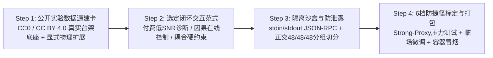

## 引言：为什么全行业都在高薪找“专家出题”，却经常出出一堆废题？

如果你最近常逛技术社区、学术动态或科研圈，大概率高频刷到一个词：**“专家出题”（Expert-Authored Benchmarks / Environments）**。

从学术界的 *Humanity’s Last Exam (HLE)*、*FrontierMath*、*PaperBench*、*SuperGPQA*，到各大模型实验室高薪邀请理工科硕博和一线工程师闭门编写高难度评测环境，行业已经达成了一个共识：**靠互联网公开教材、维基百科和 Kaggle 历史竞赛攒出来的静态题库已经彻底饱和，模型靠预训练记忆就能考到 90% 以上，测不出真实科研与工程交付能力。**

但真正一线带队出过物理、控制、化学或工业工程类评测题的人，往往会很快撞上一堵令人崩溃的墙：

> **很多领域专家明明出了自以为极难的专业题，结果放进长程代码 Agent（连续自主写代码、跑实验、迭代 4–7 小时的推理代理）里一跑——要么强弱模型全军覆没、分数贴在地板上；要么弱一点的基线模型靠 500 行“局部拟合+网格搜”直接偷鸡满分，彻底丧失区分度。**

原因其实特别本质：**传统专家出题只懂“学科物理知识”，却不懂“长程自主代码 Agent 会如何作弊与走捷径”。**

这篇文章不谈虚的概念，直接给你一套从实战打磨出来的 **「保质保量工程类专家题」完整构建 SOP**——包含 **5 个可公开复用的真实科研实验数据源（含 DOI 与许可证）、4 大高区分度题型结构、防泄露 JSON-RPC 沙盒代码架构、以及 6 档防捷径校准参数表**。

---

## 一、先破除最大误区：静态 CSV 拟合题，为什么几乎必死？

在动手写第一行代码前，必须先看清工程类出题中最常见的一类“死局”——**高信噪比静态回归题（Static CSV-to-CSV Fitting）**。

很多工程背景的作者第一次出题，习惯做法是：从论文里下载一批实测数据，切分成 `train.csv` 和 `test.csv`，让 Agent 写一个 `predict.py`，看谁在测试集上的 RMSE / MAE 更低。

在真实长程 Agent 测试中，这类静态题几乎必然在以下三个陷阱里翻车：

1. **简易局部反演陷阱（Easy-LM Trap）**：如果特征与目标之间的信噪比偏高、且没有交互决策约束，哪怕是一个中等能力的编程 Agent，只要花 20 分钟写一个 `500–700` 行左右的向量化 Levenberg–Marquardt（LM）非线性最小二乘拟合 + `1.5×` 经验残差盒约束，就能直接逼近实验测量的重复性噪声下界。此时哪怕更强的推理 Agent 迭代 100 轮做复杂机理分解，也再也拉不开差距。
2. **全局常数记忆与调参过拟合**：如果可见测试集（Visible）和隐藏测试集（Hidden）的物理漂移方向一致，Agent 在可见集上多试几次就能把漂移偏差硬编码进常数表里。
3. **只有计算、没有“研究决策”**：真实科研与工程调试从来不是“给定全量无噪数据算一遍”，而是在**测试台架预算有限、诊断信号互相混淆、控制动作彼此冲突**的前提下，一边花钱做关键实验确认病因，一边在硬约束下做鲁棒设计与闭环控制。

> **对比实证结论**：在我们对同一批物理课题（如高频磁芯铁损、多孔声学吸声、PEM 燃料电池电堆）的对照改造中，**纯静态 CSV 版题目 3 题全部未通过有效区分度门禁（`0/3`）**；而将完全相同的实测底层数据改造成**“受限付费诊断 + 物理因果闭环 / 硬约束混合整数设计”**后，**3 题全部一次通过高区分度检验（`3/3`）**，真正拉出了“浅层规则/局部拟合”与“先验机理建模 + 贝叶斯后验规划 + 鲁棒 MPC”之间的代差。

---

## 二、实战总览：一道高质量工程类专家题的 4 步流水线


把“出一道好题”工程化，核心流程收敛为这四个强约束环节：



下面把每一步直接拆成可照抄落地的工程规范。

---

## 三、Step 1：数据源怎么选？公布 5 个可直接复用的开源真实实验底座

好题目第一条铁律是**真实科研血统与清晰可审计的许可证（Provenance Hygiene）**。切忌随手拿大语言模型编造假物理数字，那样不仅数值规律失真，审稿和同行复现时也站不住脚。

最稳妥的做法是采用 **“公开高信噪比实测底座（CC0 / CC BY 4.0） + 严格公开透明的物理引擎扩展”** 双层架构：基础材料本构、台架测量曲线、试验矩阵全部来自同行评审期刊/Zenodo 原始实测文件，并记录精确 SHA-256；测量噪声、腔室漂移、热失控平衡或宽带多层器件扩展则由公开可读的物理方程引擎严格驱动。

以下 5 个经过工程实战验证、互不重叠的开源物理工程数据源，你可以直接按规范引用（均已完成实测核验）：

| 领域方向 | 核心物理机制与工程争点 | 上游原始数据源 / 论文 DOI | 开源协议 |
| :--- | :--- | :--- | :--- |
| **1. 多层光学镀膜逆向设计** | 实测复折射率色散 $n(\lambda),k(\lambda)$、腔室沉积速率 drift 标定、$2\times 2$ 传输矩阵（TMM）斜入射双偏振与残余应力平衡硬约束 | *Scientific Data* 11, 94 (2024)<br>DOI: `10.1038/s41597-023-02898-2`<br>Repo: `polyanskiy/refractiveindex.info-database` | **CC0 1.0** |
| **2. 多风机偏航尾流场建模** | G1 缩比风机风洞 Scanning LiDAR 实测尾流、偏航诱发非对称涡对偏转、多机尾流叠加与流向动量通量守恒外推 | TUM / PoliMi Wind Tunnel Dataset<br>Zenodo DOI: `10.5281/zenodo.18731994` | **CC BY 4.0** |
| **3. 高频铁氧体非正弦磁损** | EPCOS TDK N87 磁芯常温/变温任意波形实测铁损、iGSE / CWH 复合波形机理分解、自热平衡与热失控拐点（$dP_{core}/dT \ge 1/R_{th}$） | MagNet Initiative (IEEE APEC 2023)<br>DOI: `10.1109/APEC43580.2023.10131348`<br>Zenodo DOI: `10.5281/zenodo.7368936` | **CC BY 4.0** |
| **4. 多孔材料 JCA 声学反演** | ISO 10534-2 双传声器阻抗管 864 组吸声曲线 + 试件游标实测直径偏差引发的周向气隙泄露分离、多层宽带 TMM 声学器件协同优化 | TU Graz / Univ. of Naples (*Acta Acustica* 2025)<br>DOI: `10.1051/aacus/2025033`<br>Zenodo DOI: `10.5281/zenodo.15407780` | **CC BY 4.0** |
| **5. PEM 燃料电池极化与阻抗谱** | HyFaB 10 节短堆温/压/湿/计量比敏感性扫描 + 空间分辨 EIS 复阻抗谱、膜干涸 vs 阴极水淹（同表象、反控制动作）在线因果纠偏 | RealHyFC / HyFaB (*Fuel Cells* 2026)<br>DOI: `10.1002/fuce.70057`<br>Zenodo DOI: `10.5281/zenodo.19068126` | **CC BY 4.0** |

在工程目录里，强烈建议强制配两份元数据卡：**`SOURCE_CARD.md`**（人工可读的原始文献、DOI、作者、License 与文件级 MD5/SHA-256 核对表）和 **`DATA_CARD.json`**（程序可审计的实测字段与物理仿真扩展边界声明），把“哪部分是实验室真测的、哪部分是仿真模型扩展的”写得明明白白。

---

## 四、Step 2：设计不靠背题、只拼真功夫的 4 大题型范式

有了好数据，怎么设计题目才不会被 500 行曲线拟合直接打穿？实践证明，以下 4 种闭环机制最能稳定区分“真正做物理建模与不确定性规划的强 Agent”和“硬写阈值规则/点估计的弱模型”：

### 1. 付费低信噪比诊断 + 耦合硬约束混合整数设计
- **机制**：每个测试工况隐藏 6–10 个真实批次/试件潜变量（如局部气隙偏差、材料漂移因子、损耗热阻等）。求解器拥有严格有限的台架测试预算（例如只能通过 `case.query(test_id)` 购买 12–14 个诊断测试里的 **2 项**），随后输出离散材料选型 + 连续结构参数的混合设计。
- **关键坑点**：**千万不要让单次诊断直接返回“无噪声高清全频谱”！** 如果 2 个诊断返回上百个高精度频点，常规向量化 LM 几秒钟就能把潜变量过定反演死。工程上应当像真实台架一样，返回**3–6 个带现实噪声的紧凑标量/频带统计读数**，故意保留**结构化的相关后验不确定性**，逼迫 Agent 使用贝叶斯后验粒子云/拉普拉斯近似 + 鲁棒最坏情况包络优化，而不是单纯的点估计 + 1.5 倍安全盒。
- **加分技巧（自适应分支诊断）**：把第 1 次查询设计成“分诊筛查（Triage Probe）”或给出部分可观工况线索，配套 4–6 个正交专精复测项目，确保**没有任何一组固定 2 测试组合能通吃所有故障族**。

### 2. 严格因果在线闭环控制 + 冲突故障分支
- **机制**：典型如 PEM 燃料电池在线运行控制：在直流表观信号（如单池电压下跌）上，**质子膜干涸（Dryout）** 与 **阴极水淹（Flooding）** 表现几乎一致，但所需的控制动作**完全相反**（干涸要升露点/降计量比，水淹要大计量比吹扫/降露点）。
- **关键坑点**：在严格因果时间步循环中，执行器有速率限制与热/水惯性滞后，且付费在线诊断（如有限次 EIS 阻抗谱扫频）有预算上限。浅层 Agent 通常写一个 500 行双阈值锁存状态机就交卷，而强 Agent 会演化出结合卡尔曼滤波/正则化粒子滤波的状态观测器与滚动时域模型预测控制（MPC）。

### 3. 历史依赖型多工况工艺/结构优化
- **机制**：如固化动力学、塑形/屈曲记忆、渗流固结等时间演化方程，早期工艺曲线的选择会永久锁定后续多极端边界工况的可行域，在最坏情况包络下极难靠贪心凑数满足所有边界。

### 4. 稀疏自适应反演与带剂量预算的因果调度
- **机制**：探测器记忆效应/辐射剂量受限下的主动采样选点，或在 DAG 依赖与执行延迟约束下的在线资源调度。

---

## 五、Step 3：零泄露沙盒架构与标准文件布局

想要评测结果可信，**绝对不能把评测逻辑和隐藏真值放在候选代码同进程或同一份可读文件系统里**。否则 Agent 哪怕无意中扫目录、或者直接 `import` 内存检查，都会造成毁灭性泄露。

标准工程目录应做到 **Environment（交付给 Agent 的工作区）** 与 **Verifier（独立判分容器）** 严格分离：

```text
<TaskName>/
├── DATA_CARD.json              # 真实实验数据 vs 物理扩展透明边界卡
├── SOURCE_CARD.md              # 原始文献 DOI、协议与文件 SHA-256 核对卡
├── instruction.md              # 纯净英文任务书（严禁出现任何模型名或隐藏锚点）
├── requirements.txt            # 锁定版本依赖
├── data/
│   └── train/                  # 仅暴露 Train 组实测校准文件与 train_cases.json
├── engine/
│   ├── task_model.py           # 100% 公开的物理前向与约束方程（支持求导/伴随/观测器构造）
│   ├── evaluator.py            # stdin/stdout JSON-RPC 进程隔离评估器
│   └── visible_cases.json      # 仅含可见测试工况输入参数（严禁放 visible_truth！）
├── methods/
│   ├── main/method.py          # 初始保守工程 Baseline 实现 (规范: fit + Method.solve)
│   ├── selfcheck.py            # 供 Agent 自行验证 48/48 可行性与 Visible 得分
│   └── score_norm.py           # 归一化计分函数（独立封装）
└── tests/                      # 【仅存在于 Verifier 隔离容器，不对 Agent 可见】
    ├── grade.py                # 正式评分入口，强制从零重新 fit() 并先后跑 Visible & Hidden
    ├── fixtures/
    │   ├── train/              # 与 data/train 字节一致镜像，防止 Agent 篡改训练数据
    │   ├── hidden_cases.json   # 独立隐藏工况与潜变量真值
    │   ├── anchors.json        # Baseline 与 Author Reference 原始损失锚点
    │   └── FIXTURE_SHA256.json # 全部标准文件与引擎哈希校验表
    └── test.sh                 # 纯 LF 换行符容器评分入口脚本
```

核心隔离原理写在 `engine/evaluator.py` 里，遵循三条铁律：

1. **子进程边界与管道隔离**：主评判进程校验完候选代码目录哈希（拒绝软链接和路径逃逸）后，先拉起隔离进程运行 `fit(train_dir, tmp_artifact_dir)` 生成持久化模型产物；随后再拉起第二个隔离 Worker 进程加载 `Method(tmp_artifact_dir).solve(case)`。测试案例内部的潜变量 `_latent`、随机数种子 `_query_seed` 和分组标签 **永远留在父进程内存中，只通过 OS 管道上的单行 JSON-RPC 响应 `case.query(...)` 请求**。
2. **正交工况切分（48 / 48 / 48）**：`Train = 48`、`Visible = 48`、`Hidden = 48`（典型配置为 **6 个正交物理机制组 × 4 种场景族 × 2 次实现**）。Visible 与 Hidden 的扰动方向必须做正交或对称分布，确保“在 Visible 上死记硬背一个漂移修正系数”的投机策略放到 Hidden 上得分不升反降。
3. **截断 QC 分布与尾风险聚合**：工业生产批次元器件参数是有质量抽检上下界的，不要用无界正态分布去生成工况参数（否则极端 $4.5\sigma$ 离群点会让任何优秀算法偶发 `47/48` 挂掉）。建议将潜变量截断在工程公差界（如 $\pm 1.7\sigma \sim 2.0\sigma$），同时采用**尾风险加权聚合**防止模型靠简单工况拉高平均分而摆烂极值：

$$\text{group\_loss} = 0.70 \times \text{mean}(\ell_{\text{case}}) + 0.30 \times \text{mean}(\text{top } 25\% \text{ worst }\ell_{\text{case}})$$

$$\text{raw\_loss} = 0.75 \times \text{mean}(\text{group\_losses}) + 0.25 \times \max(\text{group\_losses})$$

并对全部 48 个工况执行零容忍硬可行性闸门（`max_violation <= 1e-7`）：哪怕 48 个里只违背了 1 个工况的安全边界，整体 `feasible = False`、`reward = 0.0`。

---

## 六、Step 4：决定题目成败的核心工艺——6 档本地校准与临场微调

大多数自研题目翻车，是因为作者只测了一个“很弱的空 Baseline”和一个“自己手写的 Reference”。**真正上线跑长程 Agent 时，一般模型实际表现往往比你随手写的简单代理还要强出不少（实测压缩率经常达到 1.44× 到 2.44×）。**

因此，在把题库交付给长程评测之前，必须在本地用真实的 `tests/grade.py` 跑通下面这 **6 档标定阶梯**：

| 标定档位 | 它模拟什么角色 | 48/48 可行性要求 | Hidden 归一化目标分 | 为什么这一步绝对不能省 |
| :--- | :--- | :--- | :--- | :--- |
| **0. `Baseline`** | 随机附带的合法保守工程策略 | **48/48 全过**（`min_margin > 0`） | **`0.0000`**（耗时 `< 5s`） | 防止基准过水，白送弱模型高分 |
| **1. `Unrobust_Greedy`** | 忽略后验不确定性的名义点估计贪心求解器 | **必须失败（`< 40/48`）** | **`0.0000`（不可行）** | 用硬结果证明不确定性建模与安全包络是物理刚需，不是选修课 |
| **2. `NoQuery / NoDiag`** | 只靠先验分布、花 0 次诊断预算的强鲁棒优化器 | **48/48 全过** | **`≤ 0.22`** | 验证付费诊断测试确实携带决定性的信息价值（VoI） |
| **3. `Basic_Proxy`** | 固定默认测试对 + 简单拟合 + 固定安全余量 | **48/48 全过** | **`[0.12, 0.24]`** | 建立初步基线区分度下界 |
| **3.5 `Strong_Proxy`（必测！）** | **模拟“7 小时常规模型极限反演”**：向量化物理副本 + 多起点 LM 点反演 + `1.5×` 经验训练残差盒（控制题则为多规则锁存状态机） | **48/48 全过** | **`≤ 0.32`**（硬红线 `≤ 0.36`） | **上线前直接拦截“高信噪比简易 LM 陷阱”！** 确保与 Reference 拉开 `≥ 0.28` 空间 |
| **4. `Author_Reference`** | 序列贝叶斯 VoI + 粒子/拉普拉斯后验云 + 鲁棒联合设计 / MPC | **48/48 全过** | **`0.6000`**（耗时 `≤ 25s`） | 作为 `0.60` 核心锚点（见下方归一化公式） |
| **5. `Oracle_Headroom`** | 全信息神谕解（或更深一层搜索上限） | **48/48 全过** | **原始损失比 Ref 再低 `15%–25%`** | 既留足让强模型超越作者解的空间（冲刺 `0.60–0.72`），又防止区间过窄撞上噪声地板 |

这里的归一化计分采用锚定区间映射：设同版本 `Baseline` 隐藏集原始损失为 $B$（对应 `0.00` 分），最佳合法参考水平 `Author Reference` 损失为 $R$（对应 `0.60` 分），池化校准上界 $A = \min(L_{\text{cand}}, R)$：

$$\text{Score}(L) = \text{clip}\left(0.60 \times \frac{B - L}{B - A},\ 0.0,\ 1.0\right)$$

### 临场微调决策树（出现指标异常怎么改物理参数）

- **`Strong_Proxy > 0.38`**：立刻降低单次诊断信噪比，把高清连续谱压缩成带噪声的紧凑标量/频带特征，或者让每个诊断读数耦合 2–3 个潜变量（制造相关零空间山脊）；控制题则加严执行器滞后与互斥故障边界的交叉混淆。
- **`Unrobust_Greedy` 居然过了 `≥ 44/48`**：说明物理边界太宽松，收紧 2–3 个关键失效角（如热失控斜率、最小电压下限、共振凹陷下界）的安全余量，放大未测潜变量的包络敏感度。
- **任何一条声明的物理机理消融实验掉分 `< 0.05`**：说明这个物理项在目标函数或约束里其实处于“休眠状态”，立刻重调无量纲权重或激励区间，保证宣传的每一个物理机制都真刀真枪影响结果。

---

## 七、Step 5：最终打包防坑与容器上线自检清单

一套好题在真正交给自动化容器调度平台前，最后 10 分钟必须走完这 6 项硬件级检查：

1. **纯离线可构建**：评测镜像在 `--network none --pull=false` 下直接安装本地固定 `cp312` 离线 wheel 包完成初始化，杜绝运行时连网拉包导致实验中断或偷查外部接口。
2. **文件镜像与篡改校验**：`engine/` 下公开的 `task_model.py`、`evaluator.py`、`visible_cases.json` 必须与 `tests/` 内校验副本**字节级完全一致**；`tests/grade.py` 启动前先核验 `FIXTURE_SHA256.json`，防止越权修改测试环境。
3. **负样本单元测试 100% 拒判**：`nop`（空方法）、`infeasible`（越界解）、`over_budget_query`（超预算调用诊断）、`invalid_query_id`、`bad_schema`、`latent_peek_attempt`（探测隐藏字段），外加因果控制题特有的 `incomplete_episode` 和 `future_peek`，全部必须稳定返回 `feasible=False, reward=0.0`。
4. **公开发布包零泄露复跑**：把给 Agent 看的目录单独打成干净压缩包，解压到一个完全没有 `tests/` 目录的空文件夹里运行 `python methods/selfcheck.py --split visible`，确认 `48/48` 可行且 `0.0000` 跑通、零 Hidden 关键词残留。
5. **纯 LF 行尾**：在 Windows 下写完 `tests/test.sh` 和 `solution/solve.sh` 一定要转成 `\n`（LF），否则进 Linux Docker 容器第一句就报 `/bin/bash^M: bad interpreter`。
6. **快速自检延迟控制**：尽量把单次 `selfcheck.py` 向量化压在 **`1–25` 秒**内——在 7 小时实跑周期里，极快的实验闭环能支撑顶尖 Agent 真正跑完 `90–300+` 轮假设与消融迭代，而不是把预算全耗在等单次仿真跑完上。

---

## 写在最后

回过头看，“专家出题”之所以突然成为大模型下半场的焦点，本质上是因为**通用知识考试已经到头了，AI 真正稀缺的是“能在复杂不确定世界里自己设计实验、修正模型、守住硬约束并长程交付”的试金石**。

只要你手里握着真实行业机理，再按上面这套**“真实实验 DOI 底盘 + 低信噪比付费闭环 + RPC 隔离 + Strong-Proxy 六档压测”**的工程方法去打磨题目，你出出来的就不再是一次性消耗的题库，而是真正经得起长程自主科研 Agent 考验的高质量工程基准。
